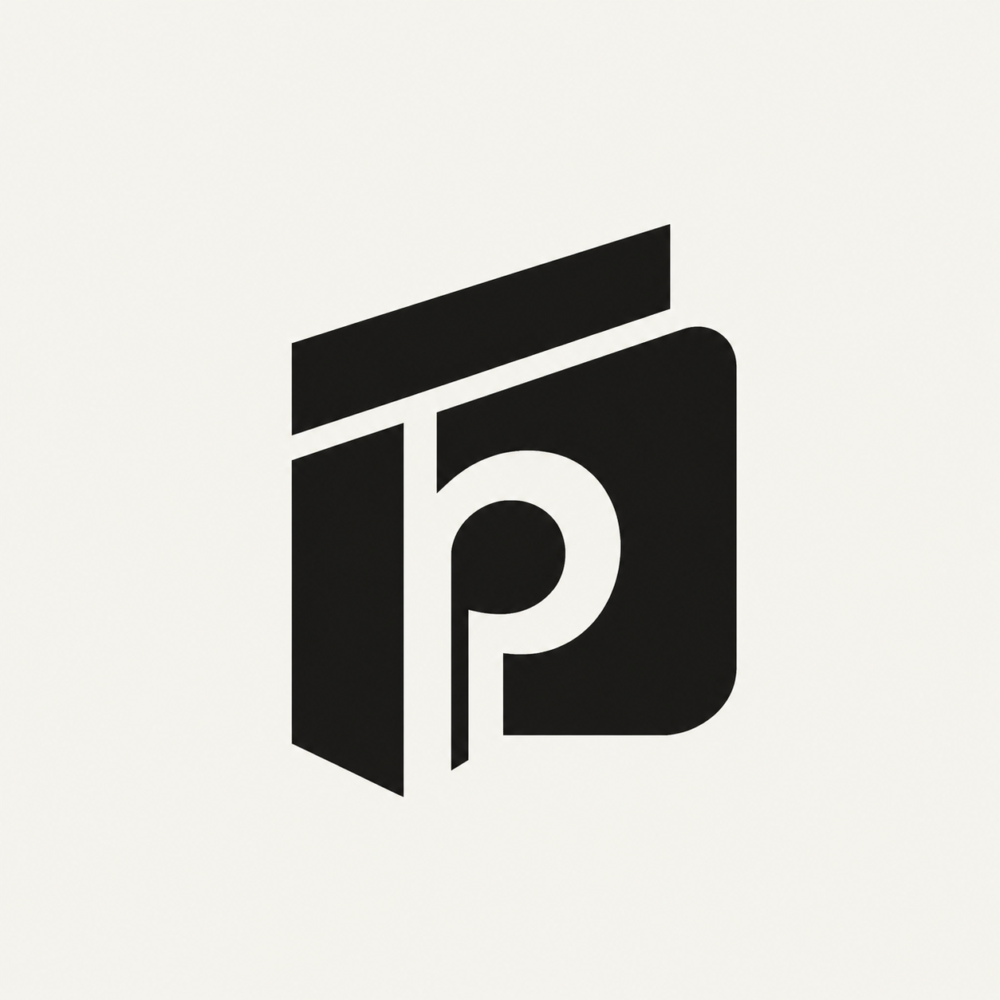
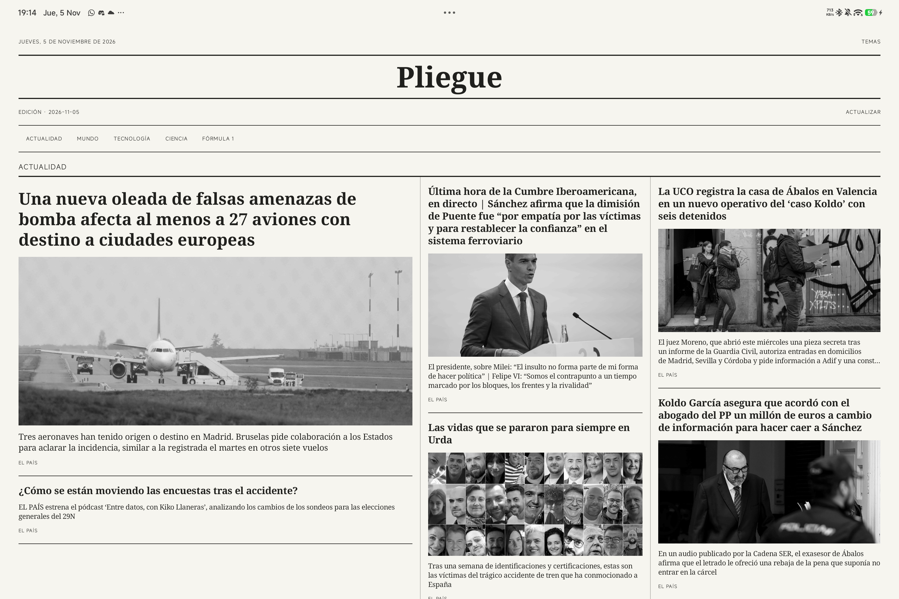
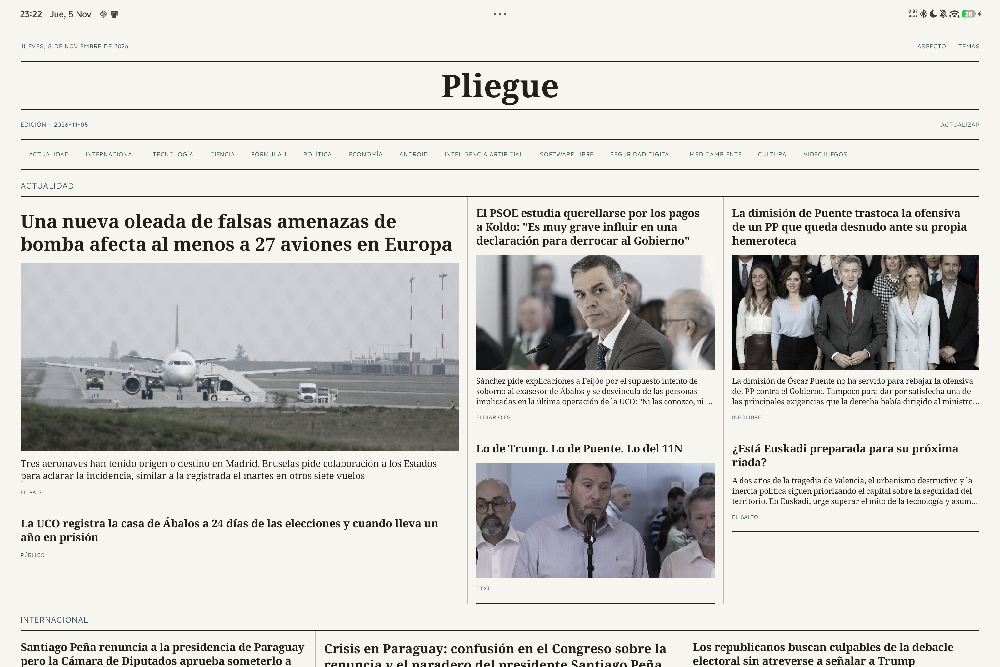

# Pliegue

<p align="center"></p>

Periódico personal para Android, pensado para tablets. Portada de varias columnas y anchos distintos, fotografías en escala de grises y lectura de noticias dentro de la app.

[Descargar APK 0.7.0](https://github.com/PabloValencia14/Pliegue/releases/tag/v0.7.0)

## Lectura

- Catorce temas activables desde la app: actualidad, internacional, tecnología, ciencia, Fórmula 1, política, economía, Android, inteligencia artificial, software libre, seguridad digital, medioambiente, cultura y videojuegos.
- Actualidad reúne El País, elDiario.es, infoLibre, Público, CTXT, El Salto, La Marea, ElPlural y Nueva Tribuna. Internacional combina BBC Mundo, El País, elDiario.es, infoLibre y El Salto. Las fuentes se alternan antes de aplicar el límite del catálogo, para repartir los primeros titulares entre medios.
- Una selección inicial por temas y más noticias al bajar, sin duplicar enlaces ya mostrados. Cuando se agota el catálogo descargado se comprueban nuevas publicaciones; si no las hay, se indica y se puede reintentar.
- Al pulsar una noticia se abre directamente un lector nativo con texto seleccionable y fotografías en gris. Conserva párrafos, subtítulos e imágenes sin ejecutar la página web del medio.
- El lector usa [Readability4J](https://github.com/dankito/Readability4J), adaptación del motor de lectura de Firefox también empleada por [Read You](https://github.com/ReadYouApp/ReadYou/blob/main/app/src/main/java/me/ash/reader/infrastructure/html/Readability.kt), junto a reglas de selección comprobadas por medio. Se compara el cuerpo de la página con el contenido público de su canal y se eliminan llamadas a seguir leyendo, promociones, recomendaciones y pies automáticos de publicación.
- Edición guardada en la tablet y actualización diaria con notificación a partir de las 8:00. Android puede retrasarla por ahorro de batería o falta de conexión.
- Estética de papel y tinta: tamaños de titulares distintos y piezas que ocupan varias columnas. Los bloques se miden al ancho real y se reparten para equilibrar las alturas y reducir huecos.
- «Aspecto» permite elegir «Tinta monocroma» o «Tinta a color» en la portada y en el lector. El modo a color usa fotos con saturación suave y etiquetas en azul petróleo; mantiene los titulares oscuros y el fondo de papel. La elección se guarda y se aplica sin perder la posición ni descargar otra copia de las imágenes.

Dentro de cada fuente se conserva su orden de publicación, sin resúmenes generados por IA. Las fuentes tienen un número finito de artículos: la carga continua añade los disponibles y no inventa contenido. Se leen canales RSS y Atom; Público se recoge de su portada pública porque no se ha encontrado un RSS operativo. Si cambia la estructura de esa portada, habrá que adaptar su extracción. CTXT se lee hasta el cierre del RSS y sus enlaces antiguos se convierten a HTTPS. El cambio de nombre de Mundo a Internacional conserva la selección y las noticias guardadas. Videojuegos utiliza VidaExtra; se retiran del catálogo los enlaces del antiguo RSS de MeriStation, detenido en 2023 y con páginas eliminadas.

El contenido completo que un editor publica en su RSS es una fuente pública independiente de su página web. Se preserva cuando está disponible y se utiliza la página para completar los canales abreviados. Si el medio no proporciona el cuerpo completo, se indica «Texto parcial»; no se recupera contenido protegido mediante sesiones, cookies ni proxies. El texto extraído completo se guarda durante 24 horas en una caché privada de hasta 8 MiB; se invalidan las extracciones de versiones anteriores para no conservar recortes ni promociones. Las fotografías usan caché de memoria y necesitan conexión tras cerrar el proceso.





## Instalar

Descargar el APK de la sección [Releases](https://github.com/PabloValencia14/Pliegue/releases), permitir su instalación y abrir Pliegue. Las actualizaciones conservan los datos si se instalan sobre la app existente; no desinstalar primero.

Es una versión de desarrollo firmada con la clave de desarrollo de la instalación original. Los artefactos de CI usan su propia firma temporal y sirven para verificar la compilación; para actualizar la app instalada, utilizar el APK adjunto a la versión publicada.

## Compilar

Android 9 o posterior. Requiere JDK 17, Android SDK con plataforma 36 y `ANDROID_HOME` configurado.

```sh
./gradlew :app:assembleDebug
```

En Windows:

```powershell
.\gradlew.bat :app:assembleDebug
```

El APK se genera en `app/build/outputs/apk/debug/app-debug.apk`.

## Comprobar

Con el APK instalado en un emulador Android de tamaño tablet:

```sh
python tests/check_ui.py emulator-5554
```

Comprueba fotografías, columnas, selección persistente de ambos modos de tinta, apertura directa, lector nativo sin WebView, vuelta, carga de noticias posteriores al primer lote y giro sin volver al inicio. Solo modifica emuladores. Las capturas se guardan en `app/build/ui-check`.

`./gradlew :app:testDebugUnitTest` comprueba extracción de texto y fotos, cuerpos divididos en varios bloques, texto estructurado y URLs con seguimiento, limpieza de promociones sin borrar prosa real, separación de otras noticias, restricciones de acceso, límites y caché, configuración y alternancia de fuentes, migración del catálogo y portada de Público.

`ArticleColumnsCheck.java` comprueba anchos y reparto de bloques con alturas desiguales mediante Java estándar. `NewsImagesCheck.java` contiene 17 comprobaciones del parser de RSS, Atom, imágenes y metadatos de contenido completo. `NewsPaginationCheck.java` comprueba paginación, enlaces únicos, fin del catálogo y nuevas publicaciones, y `NewsPreferencesCheck.java` comprueba la preferencia antigua de Mundo y las elecciones explícitas de Internacional. Se ejecutan con el runtime Android mediante `app_process`.

## Desarrollo

Proyecto Java con [Jsoup](https://jsoup.org/) y Readability4J para analizar HTML, sin servidor propio ni clave de API. [Avisos de bibliotecas](THIRD_PARTY_NOTICES.md). El identificador `es.pablo.periodico` mantiene la compatibilidad con las primeras instalaciones.

El tablero del proyecto está en `kanvas.json`; sus instrucciones se encuentran en `.agents/skills/kanvas/SKILL.md`.

La versión 0.7.0 se ha comprobado en una Pad 7 con Android 16 con 34 noticias reales de 17 fuentes: 32 ofrecen extracción completa; las dos muestras de El País rechazan la descarga con HTTP 403 y permanecen indicadas como parciales. La revisión del cuerpo incluye primeros y últimos párrafos, fotos editoriales y las 23 filas de tablas de una noticia de Fórmula 1. En la interfaz real se ha llegado al final de una entrevista de Público y de esa noticia de F1, sin WebView ni pies automáticos de publicación. Pasan las 38 pruebas unitarias y las comprobaciones Android de RSS/Atom, metadatos, paginación y preferencias heredadas.

Las comprobaciones anteriores de portada, fotografías, tinta a color y monocroma, desplazamiento, giro y carga de otro lote siguen documentadas en las versiones 0.5.0 y 0.6.0. También se forzó una actualización en segundo plano que generó la notificación sin abrir la app. La ejecución automática natural de las 8:00 sigue pendiente de observar.
